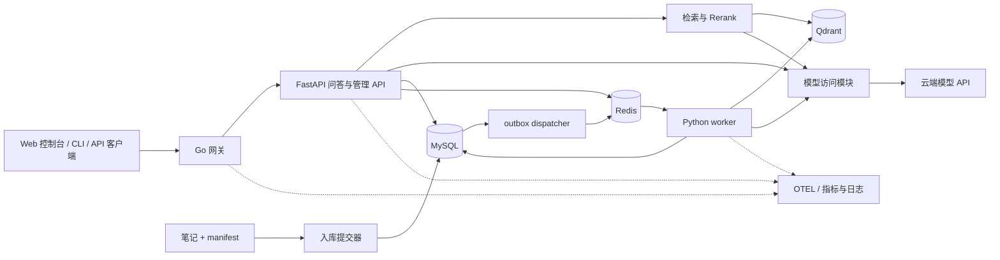

# 面试知识库 RAG 问答系统：技术设计与交付方案

- 文档状态：设计草案，待用户确认；尚未实现或连接外部服务。
- 更新日期：2026-09-09。
- 项目入口：[项目 README](../README.md)。
- 设计依据：Stage 4 系统设计（作者知识库笔记，未随本仓库分发）。

## 1. 方案概览与决策状态

构建一个有来源引用、可增量更新、可追踪知识版本的问答系统。采用 **Go 接入网关 + Python 模块化单体 + 独立入库 worker**，模型通过云端 API 调用，Qdrant 承担向量检索。在线服务与 worker 共享 Python 业务模块，分别扩容；第一版不拆分检索、生成等微服务。

“生产级”落实为权限边界、数据一致性、可恢复任务、限流与取消传播、评估、可观测和交付演练。单机 Docker Compose 用于开发和集成验收，不代表已经具备生产高可用；对外生产部署需要另外通过第 12 节的部署与恢复验收。

| 决策 | 当前状态 | 设计采用的方案 |
|------|----------|----------------|
| 模型来源 | 已确认 | 生成、Embedding、Rerank 使用云端 API |
| 服务形态 | 已确认 | Python 单体核心服务 + Go 网关 |
| 向量存储 | 已确认 | Qdrant |
| 语料清单 | 用户明确要求 | 显式维护 `data/manifest.json`，记录路径、标题、hash、更新时间 |
| 本地调试 | 用户明确要求 | Docker Compose 提供本地依赖、mock 模型和一键脚本；真实云端模型按环境切换 |
| Web 操作页 | 用户明确要求，方案待确认 | 第一版提供本地问答与语料管理控制台，不作为对外多租户产品页面 |
| 框架分工 | 本文建议，待确认 | LangChain 部分组件；基础 RAG 显式编排；增强流程使用 LangGraph |
| 业务库与异步任务 | 本文建议，待确认 | MySQL、Redis、arq；MySQL 保存任务事实与 outbox |
| 云端供应商 | 尚未确认 | 候选 DeepSeek / Qwen 生成服务、SiliconFlow Embedding 与 Rerank；按实际账号验证 |
| 性能与质量指标 | 初始验收提案 | 见第 11 节，必须用实测数据调整和证明 |

此前的 DeepSeek + SiliconFlow 组合只是候选，不视为已确认采购或模型可用性。Qwen-Agent 官方中文 README 说明它支持 DashScope 和 OpenAI 兼容模型服务，提供可选 RAG、Assistant 文件读取与 Gradio GUI，因此可以用它快速搭出本地知识问答 Demo。但它不直接提供本设计中的 manifest diff、源快照、generation 原子发布、MySQL 答案证据、分布式配额、压测与备份验收；因此本项目只把它作为可选实验或质量对比运行时，不替代主链路。LangChain 的高层封装也可以被理解和测试，选择显式编排是为了让检索策略、引用、预算和降级边界更清楚。

## 2. 交付范围与使用流程

基础交付包含：知识源管理、异步增量入库、混合检索与重排、多轮问答、SSE 流式输出、来源版本查询、反馈、鉴权、限流、评估、压测及部署运行手册。使用入口为 HTTP API、命令行、OpenAPI 文档和本地 Web 控制台；Web 控制台只调用 Go 网关暴露的 API，不绕过鉴权、限流和版本校验，也不承载独立业务规则。第一版页面面向本地调试和管理验收，不承诺对外多租户产品级前端。

第一版是单知识库、多访问主体模型：`reader` 可查询和管理自己的会话，`admin` 可发布语料与查看入库任务。认证主体由网关确定，核心服务继续校验会话和答案归属。暂不承诺多租户隔离或文档级 ACL；未来开放多知识库时，需要同步改造检索过滤、缓存命名空间和权限回归。

典型使用流程：

1. 管理者将经过整理的笔记加入 manifest，查看待新增、修改、停用的文件差异。
2. 提交异步入库，系统冻结源文件快照，构建新索引，验证后发布。
3. 用户携带 API Key 提问，通过 SSE 收到答案，并获得与本次索引绑定的引用。
4. 笔记发生修改后，旧答案仍能查看当时的证据；新问题使用新发布的索引。
5. 管理者运行固定评估集，检查更新是否改善检索质量，必要时回滚索引。

LangGraph 增强版在基础交付后实现受预算约束的查询改写、补充检索与证据检查。默认请求走单趟 RAG，复杂问题才进入增强流程；首版不增加任意代码执行、网页抓取或其他有外部副作用的工具。

## 3. 架构与职责



| 模块 | 主要职责 | 不承担的职责 |
|------|----------|--------------|
| Go 网关 | API Key 验证、角色与主体传递、请求大小限制、Redis 限流、SSE 透传、trace、取消传播 | RAG 策略、提示词、文档解析 |
| Web 控制台 | 本地登录、问答、引用展开、manifest 审阅、入库监控与索引发布操作 | 绕过网关访问核心服务；自行实现检索、权限或发布规则 |
| FastAPI API | 协议校验、资源归属校验、会话与答案记录、调用应用层、流式事件 | 执行耗时入库任务 |
| RAG 应用层 | 固定索引版本、问题改写、检索策略、证据选择、提示词、引用与失败处理 | 绑定具体供应商响应结构 |
| 检索模块 | Dense / Sparse 查询、RRF、去重、Rerank、上下文预算 | 直接执行文档中的指令 |
| 模型访问模块 | 生成、Embedding、Rerank 适配，超时、重试、配额、成本记录 | 再部署一个独立“LLM 网关”服务 |
| 入库 worker | 读取冻结快照、解析切分、生成向量、构建并验证索引、发布 | 改写人工维护的 manifest |
| 评估模块 | 固定数据集回归、消融实验、裁判校准、质量和性能报告 | 用 mock 指标证明真实模型质量 |

只有 Go 网关暴露客户端端口。Python 与数据库通过内部网络通信；网关覆盖客户端传入的身份头，核心服务验证内部认证凭据，不能仅凭“在内网”信任身份。生产环境由入口代理或负载均衡器终止 TLS，内部跨主机通信采用加密连接。

## 4. 技术选型与框架边界

| 领域 | 建议技术 | 选择理由与代价 |
|------|----------|----------------|
| Python 服务 | FastAPI、Pydantic、httpx；uv 管理环境与锁文件 | 适配 AI 生态和异步 I/O；CPU 密集处理放 worker，避免阻塞事件循环 |
| Go 网关 | 标准库 `net/http`、反向代理、Redis 客户端 | 练习接入、并发和流式代理；增加一种语言，但服务边界明确 |
| Web 控制台 | React、TypeScript、Vite、Tailwind、TanStack Query | 适合本地调试与管理验收，构建为静态资源由网关分发；不引入 Next.js 等服务端前端，避免重复鉴权与部署边界 |
| 本地调试 | Docker Compose profiles、Makefile / shell 脚本、mock OpenAI 兼容模型 | 无云 Key 也能测试 API、入库、SSE、发布与回滚；mock 结果不得作为真实质量或性能证据 |
| Markdown 解析 | `markdown-it-py` + frontmatter 解析 | 保留标题、代码块、表格与源行号；不能仅用正则按 `#` 切分 |
| LangChain | 按需引入 `langchain-text-splitters` 等独立包 | 用于超长段落的递归切分等组件；源位置与元数据由项目自身维护 |
| LangGraph | 第二阶段用于有条件分支和循环的工作流 | 状态和步骤显式；带来状态 schema、重放与持久化选型成本 |
| Qwen-Agent | 不作为默认主运行时；可作为可选实验适配层 | 官方支持 RAG、工具调用和 Gradio GUI，可快速验证 Qwen 能力；主链路仍由本项目控制 manifest、版本、引用、发布与评估 |
| 生成 / Embedding 接入 | 支持的 OpenAI 兼容 SDK 或 httpx 适配器 | 统一项目接口，不假设不同服务商的参数、流式 usage、工具调用完全兼容 |
| Rerank 接入 | 独立 HTTP 适配器 | 不存在可对所有供应商直接套用的 OpenAI 标准 Rerank 协议 |
| 检索 | Qdrant dense + sparse，Python BM25 编码，jieba 分词 | 支持混合召回和过滤；中文词表、分词与统计必须自行明确并评估 |
| 业务数据 | MySQL 8.4 LTS、SQLAlchemy 2、Alembic | 适配已有后端经验，事务管理业务状态；需处理与 Qdrant 的跨存储一致性 |
| 缓存 / 队列 | Redis、arq | 开发轻量，异步模型一致；队列不作为唯一可靠任务记录 |
| 可观测 | OTEL、Prometheus / Grafana、结构化日志；Langfuse 为可选追踪集成 | 通用监控作为基本能力；Langfuse 自托管另有基础设施成本 |
| 测试与交付 | pytest、Go test、真实依赖集成测试、k6、Docker Compose | 同时覆盖业务逻辑、跨存储一致性和 SSE 行为；真实模型评估单独计费 |

Python / Go 的具体版本在 P0 根据 SDK 和部署环境选择受支持稳定版，依赖写入 `uv.lock`、`go.sum`，容器固定版本或 digest，不使用浮动 `latest` 作为可复现交付依据。

模型访问仅定义当前需要的三个接口：`embed(texts)`、`rerank(query, candidates)`、`stream_chat(messages)`。每种能力分别配置 provider、base URL、模型标识、凭据、超时和并发预算；接口地址来自受控配置，不能由普通请求任意指定。Embedding 模型、维度或文本编码方式改变时必须重建索引，不能直接沿用旧向量。

### 4.1 Qwen-Agent 的两种使用方式

Qwen-Agent 可以用来搭建一个 RAG Demo，但本项目不建议把它直接放在主生产链路中。

- **方式 A（推荐）：实验对比运行时**。单独脚本或独立容器读取冻结后的 manifest / 文档快照，调用 Qwen-Agent 官方 RAG 能力生成候选答案，再走本项目评估 pipeline，与主链路对比 Evidence Recall、引用可解析率、事实支持率、延迟和成本。它不能访问生产 `answers` 表，不发布主索引，不替代版本化引用。
- **方式 B（不推荐作为 v1）：嵌入式 Agent 运行时**。只有当评估证明 Qwen-Agent 的长文档策略或工具调用明显优于主链路，且其 RAG 结果可以映射到固定 generation、文档 hash、证据文本与引用 ID 时，才考虑把它封装为一种生成策略。否则会出现两套检索、两套切分和两套引用，破坏“答案使用的是哪个版本”的可追踪性。

Gradio GUI 只作为本地实验页面候选。基础 Web 控制台不直接用 Gradio 替代，因为页面需要通过 Go 网关统一鉴权、限流、SSE、审计和 API 错误协议；Gradio 更适合快速验证模型或 Agent 行为，不适合作为生产操作台。

### 4.2 本地调试模式

本地调试使用 Docker Compose profiles，同一套代码按环境切换依赖：

| profile | 启动内容 | 用途 |
|---------|----------|------|
| `infra` | MySQL、Redis、Qdrant | 验证存储、迁移和队列行为 |
| `app` | Go 网关、FastAPI、worker、dispatcher、Web 静态资源 | 验证完整请求链路与入库发布 |
| `mock-model` | OpenAI 兼容 mock 服务 | 无云 Key 时测试 Embedding、Rerank、流式生成、超时和降级 |
| `cloud-model` | 真实云端模型配置 | 小额连通性、质量评估和费用记录 |
| `observability` | Prometheus、Grafana、可选 Langfuse | 验证指标、trace 和运行观测 |
| `experiment` | Qwen-Agent 实验脚本或独立容器 | 对比实验，不影响主链路 |

本地配置分为 `.env.example`、未入库的 `.env` 和 Compose override。默认 `make dev` 或等价脚本只启动 `infra,app,mock-model`，不访问云端；执行真实模型评估必须显式切换到 `cloud-model`，并记录模型、数据集版本、generation 与费用。页面、CLI、集成测试和评估脚本都必须能指向同一本地网关，避免绕过权限和版本校验。

### 4.3 Web 控制台范围

第一版页面是操作和调试控制台，不是通用知识库产品。建议由 Go 网关分发静态构建资源，前端只通过网关 API 访问后端，不把密钥保存在浏览器长期存储中。

| 页面 | 功能 | 权限 |
|------|------|------|
| 登录 / API Key | 输入或选择本地 Key，查看角色、当前索引 generation 与健康状态 | reader / admin |
| 问答 | 多轮对话、SSE 流式输出、停止生成、反馈、展开引用与证据版本 | reader |
| 答案追溯 | 显示 answer ID、request ID、manifest hash、文档 hash、chunk 行号范围 | 答案所有者 / admin |
| 语料管理 | 扫描候选文件、审阅 manifest diff、启用 / 停用条目、提交入库 | admin |
| 入库任务 | 查看状态、进度、错误、模型调用与重试信息 | admin |
| 索引发布 | 比较 active 与候选 generation，执行发布、回滚并填写原因 | admin |
| 评估报告 | 查看固定数据集报告、消融结果、费用与失败样例链接 | admin |

页面操作最终仍调用第 8 节 API；危险操作（发布、回滚、停用文档、删除旧索引）要求二次确认并写入审计。Web 控制台失败不能影响 CLI / API 的同等能力，本地调试也可以完全不启动页面。

## 5. 显式 manifest 与版本约定

### 5.1 清单内容

`projects/interview-rag/data/manifest.json` 是可审阅的语料纳入清单，路径统一相对于工作区根目录。初始只显式列入 Stage 0～4 五篇主题笔记，不自动收录 README、岗位建议、项目计划、协作规则、Inbox 或其他领域。

以下是 schema 示例，单条记录的文件 hash 取自本次设计时的实际文件；它不代表已经创建清单或完成入库。实现时生成全部五条记录。

```json
{
  "schema_version": 1,
  "corpus_id": "agent-interview",
  "documents": [
    {
      "doc_id": "stage-2-rag",
      "path": "corpus/agent-interview/02-rag.md",
      "title": "Stage 2：RAG 全链路",
      "hash": "sha256:ac47c02c80ebb6fdc6837f7f60616163e6034f8581ba66271140b3c171a944ee",
      "updated_at": "2026-09-08T09:19:22Z",
      "enabled": true
    }
  ]
}
```

| 字段 / 标识 | 定义与维护规则 |
|-------------|----------------|
| `doc_id` | 稳定的文档身份；重命名、移动、改标题时保持不变，不从路径动态推导 |
| `path` | 显式源文件路径；拒绝绝对路径、`..` 越界、符号链接越出允许语料目录 |
| `title` | 默认取一级标题，允许明确人工覆盖；属于检索与引用元数据 |
| `hash` | `sha256:` + 原始文件字节的 64 位十六进制摘要；不先去空格或规范化换行 |
| `updated_at` | 源文件更新时间的 UTC RFC 3339 表示；刷新内容时记录文件 mtime，仅供追踪，不作为变更判据 |
| `enabled` | 是否进入下一个目标索引；停用或移除条目属于需要审阅的语料变更 |
| `manifest_hash` | 对按 `doc_id` 排序、固定 JSON 规范序列化后的 manifest 求 SHA-256，记录本次提交快照 |
| `source_version` | 文档原始内容 hash，与路径身份分离 |
| `pipeline_fingerprint` | 解析器、切分参数、分词字典、Embedding 配置等的规范摘要 |
| `index_generation` | 一次成功构建的不可变检索快照 ID；关联 manifest、pipeline 和物理 collection |

`updated_at` 不因仅执行刷新或重新复制相同内容而自动变化；只有 hash 变化时刷新它。标题、路径或启用状态变化也进入入库 diff，不能只检查文件 hash。笔记 frontmatter 的 `updated` 若存在，可作为源元数据保存，但不能替代字节 hash。

### 5.2 人工与工具各自维护什么

人工决定新增、删除、停用、文档身份和标题覆盖；工具只为明确选中的条目计算 hash、更新时间并展示差异。自动扫描可以报告未收录文件，但不自动把它们纳入生产语料。

计划提供 CLI 操作 `manifest validate / add / refresh / diff` 与 `ingest submit / status / rollback`；这些是拟实现接口，并非当前可执行命令。刷新采用临时文件和原子替换，服务和 worker 不回写清单。启用的文件不存在、重复 `doc_id` / 路径、非法编码或 hash 不一致时，提交失败，不把缺失文件推断为删除。

manifest 表示“希望发布什么”，MySQL 的 active generation 表示“当前实际服务什么”，两个状态在构建期间允许不同。没有有效 manifest 时，系统拒绝全目录自动入库。

### 5.3 保存原始版本与答案证据

只保存 hash 无法找回旧内容。因此提交任务时读取并校验文件，将同一份已校验字节保存为不可变 `document_versions` 快照，并保存 manifest 快照；worker 只读快照，不再重新读取可能变化的工作区文件。首版将受大小限制的 Markdown 原始字节存入 MySQL `MEDIUMBLOB`，单文件上限初设 5 MiB；规模增长后迁移到按 hash 寻址的对象存储。

每条答案至少记录：`answer_id`、`request_id`、`index_generation`、`manifest_hash`、`pipeline_fingerprint`、检索配置版本、prompt 版本、provider / model、生成参数、完成状态和引用。引用保存 `doc_id`、路径和标题快照、`source_version`、`chunk_id`、标题层级、原始行号范围、实际证据文本及其 hash。

客户端可以看到“Stage 2：RAG 全链路 / 标题路径 / sha256 前缀”，完整摘要和证据通过引用 API 查询。模型只能使用本次候选证据的引用编号，服务端将编号映射为可信元数据并校验，不能采用模型自行生成的文件路径或版本号。这样可以复查当时证据，但不保证云端模型逐字重现同一答案。

## 6. 增量入库与索引发布

### 6.1 解析、切分与向量生成

1. 按 Markdown 语法树提取标题层级、正文、代码和表格，去除管理性 frontmatter，保留源行号；代码围栏内的 `#` 不当作标题。
2. 以章节为语义边界。初始目标 chunk 约 400～800 tokens，overlap 约 50～100 tokens，均为可调起点；实际按模型 tokenizer 或供应商限制校验。
3. 尽量保持代码和表格完整；超过模型输入上限时按可追踪的行或段落切分，标记续块。递归切分后保留源跨度，避免用全文字符串查找误定位重复段落。
4. Embedding 输入包含文档标题、章节路径和正文。缓存键使用实际编码输入 hash + 模型指纹，不能只用正文 hash；标题改变可能影响向量。
5. `chunk_id` 由文档身份、源版本、切分指纹、块序号和文本摘要确定；Qdrant point ID 使用对应的确定性 UUID，避免把任意 SHA 字符串当成合法 point ID。

### 6.2 变更判定

| 变化 | 处理 |
|------|------|
| 新增文档 | 保存快照、切分、编码，进入新 generation |
| 文件 hash 改变 | 生成新文档版本，重切该文档；相同实际 Embedding 输入复用向量 |
| 仅路径改变 | 保持 `doc_id`，更新引用路径快照；编码输入未变则复用向量 |
| 标题改变 | 更新元数据；若标题参与编码，则重算受影响向量 |
| 显式停用 / 移除 | 新 generation 排除文档；旧答案证据按保留策略可查 |
| 启用文件缺失或 hash 不匹配 | 阻止提交，要求修复清单或显式停用 |
| 解析 / 切分 / 分词 / Embedding 配置改变 | 新建 generation；按影响范围重新处理，维度变化创建对应新 collection |
| 内容、元数据及处理配置均未变化 | 返回 no-op，不产生模型调用与重复索引 |

首版采用“增量解析与 Embedding + 全量新索引快照发布”：只对新增或受影响内容支付模型编码成本，但新 collection 装载全部启用 chunks。它以较高的存储和向量复制成本换取一致的版本边界，适合当前五篇笔记及早期增长；必须分别报告增量模型调用量和全量索引写入量。

### 6.3 中文稀疏检索

Qdrant 支持 sparse vectors，不等于上传 Markdown 后自动具备合适的中文 BM25。首版由 Python 使用固定版本 jieba 与领域词典编码，保留 `RAG`、`top-k` 等英文术语规则，并以评估集校准。

每个 generation 保存词项 ID 映射、文档频率、chunk 数量和平均长度。文档稀疏权重编码 BM25 的 TF 与长度归一化项，查询稀疏权重编码同一快照的 IDF，通过 Qdrant 稀疏点积检索；此方案不再叠加 Qdrant 的 IDF modifier，避免重复加权。编码器用小语料手算评分做对照测试。

文档更新可能改变全局词频及平均长度，因此新 generation 重新计算 sparse 权重，不能只更新修改文档后仍沿用旧全局统计。Dense Embedding 仍可复用。

### 6.4 任务可靠性与原子发布

任务状态为 `queued → running → validating → succeeded`，异常进入 `retry_wait / failed`，用户取消进入 `cancelled`。MySQL 保存任务、重试次数、心跳和 outbox；事务提交后 dispatcher 投递 Redis 队列，worker 至少一次消费，通过确定性 IDs 与幂等写入处理重复消息。

构建与发布步骤：

1. 固化 manifest、源文件和 pipeline 配置，记录提交时的 active generation。
2. worker 为本次构建尝试分配独立 generation / collection，分批写入并记录进度；重试不能让过期 worker 写入已发布 collection。
3. 校验 chunk 数量、向量维度、版本与元数据，等待 collection 可查询，执行检索 smoke test。
4. 在 MySQL 事务内检查任务仍有效、租约未过期，并用 compare-and-swap 同时比较预期 active generation 和单调递增的 `publication_revision`，成功后切换到新 generation 并递增 revision，同时标记任务成功。
5. 手动发布与回滚使用同一 CAS 接口，也必须提供预期 generation 与 revision；若另一个任务已发布，或指针经历 `A → B → 回滚 A` 后 revision 已前进，当前任务标记冲突，重新比较后决定重建；不允许较早任务晚完成而覆盖较新的语料。

**MySQL active generation 是唯一发布指针。** 查询在开始时读取并固定它，后续直接访问该 generation 的物理 Qdrant collection，不再用一个独立切换的 Qdrant alias 充当第二个权威。Qdrant 写入成功但 MySQL 发布失败只留下未发布构建，旧服务不受影响。

失败任务由 MySQL 状态、outbox 和心跳重新调度；Redis 丢失队列后可以恢复待处理任务。过期 worker 必须通过租约版本校验才能发布，独立构建 collection 避免过期写入污染新尝试。发布后 collection 不再写入。

旧 collection 保留不少于最大请求时长加安全余量，并按配置保留最近若干次发布用于回滚；删除前确认无活跃构建或保留引用要求。原始版本与答案证据单独保留，删除旧向量不意味着删除历史证据。回滚也创建审计记录并切换 active generation；因权限或敏感内容撤销的版本不能随普通回滚重新开放。

## 7. 问答链路、会话与缓存

标准流程为：鉴权与限流 → 固定 generation → 读取授权会话 → 必要时独立化问题 → 缓存检查 → 查询编码 → 混合检索 → Rerank → 证据与 token 预算 → 生成与引用 → 保存答案与反馈入口。

Dense 查询在问题 Embedding 完成后执行，Sparse 编码与检索可与该分支并行。初始各召回 30 条，用 RRF 融合后保留约 20 条，Rerank 选出约 5～8 条进入上下文；这些是待评估的配置起点，不是质量保证。RRF 用排名而非直接相加不同比例的相似度分数。

先完成检索、证据选择，再开始依赖这些证据的生成；不能把它们并行执行作为普通 RAG 的延迟优化。证据不足时明确拒答或说明缺口。阈值根据固定数据集校准，不能把 Rerank 分数当成通用概率。

多轮会话只取授权会话的近期消息，按 token 预算截断；需要时改写为独立检索问题，记录原问题与改写结果。第一版同一会话只允许一个在途生成，冲突返回明确错误，避免并发回复污染历史；前一轮答案不能替代新一轮检索证据。

缓存按风险由低到高实施：

- Embedding 缓存：实际输入 hash + Embedding 模型指纹。
- 精确问答缓存：主体 / 知识库、generation、独立问题、会话上下文摘要、检索配置、prompt 与生成模型版本构成键；仅缓存已完成且引用有效的结果。
- 语义缓存：在精确缓存之后实现并默认关闭，作为质量实验。首版仅覆盖无历史的知识性问题，通过相似度、实体 / 数值 / 否定条件检查并用误命中评估后启用，不能只靠余弦阈值复用答案。

Redis 保存响应缓存；如启用语义缓存，近邻索引可放在 Qdrant 独立 collection，Redis 为有效条目的权威，TTL 到期即 miss。普通 Redis 本身不自动提供向量近邻搜索。所有命中仍校验主体与 generation，索引更新后旧缓存不会被新 generation 复用。

## 8. API、SSE 与模型调用边界

| 拟定接口 | 用途与约束 |
|----------|------------|
| `POST /v1/chat` | 输入问题、可选 conversation ID、是否流式；返回答案或 SSE |
| `GET /v1/answers/{id}` | 查询自己的答案、状态和版本化引用 |
| `GET /v1/answers/{id}/citations/{citation_id}` | 返回该答案保存的证据快照，不开放任意本地文件读取 |
| `POST /v1/answers/{id}/feedback` | 记录赞踩与问题类型 |
| `GET /v1/corpus/manifest-candidates` | admin 扫描允许语料目录，返回未收录或 hash 变化的候选文件，不自动修改 manifest |
| `GET /v1/corpus/manifest-diff` | admin 比较工作区 manifest 与最近提交快照，返回新增、修改、停用和缺失条目 |
| `POST /v1/ingestions` | admin 提交 manifest 与匹配的源文件快照包，校验大小、路径、hash；不接受任意服务器路径或 URL |
| `GET /v1/ingestions/{id}` | admin 查询状态、进度和失败原因 |
| `GET /v1/index-generations` | admin 查询候选、active 与保留 generation，以及构建统计 |
| `POST /v1/index-generations/{id}/activate` | admin 发布已验证版本或回滚，带预期当前 generation 与 publication revision |
| `GET /v1/system/status` | 返回依赖健康、当前 generation、队列积压和最近任务摘要；不暴露密钥 |
| `/health/live`、`/health/ready` | 存活与分角色就绪；不靠每次探针调用计费模型 |

入库 CLI 负责读取本地 manifest 和显式文件，将 JSON 元数据与文件内容作为受限 multipart 请求提交；不解压客户端提供的任意归档。服务再次计算 hash 并保存快照，避免仅相信客户端摘要。Web 控制台的候选扫描与 diff 仅用于本地调试：语料目录以只读方式挂载进 API 容器，页面不直接读写浏览器本机文件。对外部署时改用已上传的 manifest / 快照包或受控对象存储，不能依赖服务器本地笔记目录。

SSE 事件为 `meta`、`delta`、`citations`、`done`、`error`。`meta` 带 request / answer / generation ID；`citations` 给出校验后的最终引用；`done` 只在答案和引用成功持久化后发送，并包含 usage、缓存状态和是否降级。SSE 已发头后发生错误，通过 `error` 事件和答案状态表达，不能再改 HTTP 状态码。

网关禁用代理缓冲并及时 flush，配置流式写空闲超时和心跳；客户端断开要取消 Python 和模型请求，失败或部分生成标记 `interrupted / failed`，不写入成功缓存。最终引用确认前，已流出的 token 视为未完成内容。第一版不支持流式断线续传；重连通过答案 ID 查询已持久化状态，不自动重复一次模型生成。

重试仅用于可恢复的连接失败、429、部分 5xx，遵守 `Retry-After`、指数退避与总 deadline，并限制次数；认证错误、非法请求不重试。生成仅在尚未输出 token 时尝试兼容的备选模型，流开始后不能无缝拼接另一个模型。Embedding 不能临时换成不同向量空间；Rerank 超时可返回 RRF 排名并记录降级。

Go 网关限制主体请求速率和入口连接数量；模型访问层在 Redis 中协调跨副本 RPM / TPM / 在途调用额度，生成前预留 token 预算，按实际 usage 结算，不可获得准确 usage 时标记估算。同一供应商不同账号或模型的配额范围按真实规则配置。

## 9. 业务存储与安全

| 数据表 | 关键数据与约束 |
|--------|----------------|
| `documents`、`document_versions` | 稳定文档身份、源 hash、原始字节、版本元数据；文档身份 + hash 唯一 |
| `corpus_snapshots` | manifest 原文与规范摘要、成员的路径 / 标题快照，独立于当前工作区 |
| `index_generations`、`corpora` | 物理 collection、pipeline 指纹、BM25 统计引用、状态、唯一 active 指针及单调 `publication_revision` |
| `chunks`、`generation_chunks` | 文本、源跨度、Embedding 输入 hash、generation 与 chunk 对应关系 |
| `ingestion_jobs`、`outbox_events` | 幂等键、基准版本、构建尝试、租约、错误、投递与恢复状态 |
| `conversations`、`messages` | 主体归属、有序消息、同会话在途状态 |
| `answers`、`answer_citations` | 完成状态、模型与检索版本、实际证据快照、token / 费用 |
| `feedback`、`audit_events` | 质量反馈，入库、发布、回滚及关键管理操作 |

业务数据由 MySQL 负责，Qdrant 是可从冻结文档和配置重建的检索索引，Redis 是缓存、临时配额和投递媒介。Embedding 结果可作为版本化构建产物保存以便复用；成本与模型版本必须一并记录，避免重建时误用旧模型产物。

第一版 API Key 为高熵随机凭据，配置中保存带 key ID 的校验摘要、角色和主体，明文仅发放时出现；支持轮换和撤销。模型 Key 来自本地未入库的环境文件或生产 secret manager，不进入 manifest、日志、镜像和测试样例。

知识源是模型输入中的不可信数据，提示词把问题、历史、证据分区处理；文档内容不能授予工具权限或改写系统规则。引入 LangGraph 工具时只开放受限检索接口，仍在服务端做参数与授权检查。日志默认不记完整问题、笔记和答案；详细 trace 仅在显式配置后按脱敏和保留策略记录。云端 Embedding、Rerank 和生成会接收所需笔记文本，默认语料范围不扩展到工作敏感内容。

## 10. LangGraph 增强方案

标准 RAG 用显式 Python 函数编排，复用 LangChain 切分等组件；增强流程复用相同检索和模型访问接口，避免维护两套检索系统。

```text
输入与固定版本 → 问题改写 → 检索 / Rerank → 证据检查
                                      ├─ 足够 → 生成 → 引用校验 → 结束
                                      ├─ 不足且预算允许 → 补充查询 → 检索 / Rerank
                                      └─ 不足且预算用尽 → 说明证据不足 → 结束
```

State 保存问题、改写查询、证据 IDs、generation、轮数、token / 时间预算和错误；初始最多 2 轮检索，限制模型调用次数，并共享整条请求 deadline。固定 generation 在循环期间不改变。

LangGraph 不要求使用 LangChain，也不要求每个简单流程启用 checkpoint。首个增强版本在一次请求内执行，MySQL 保存答案与必要步骤摘要；它不宣称中途故障可从节点恢复。持久化 checkpoint、跨请求恢复和人工介入作为后续独立交付，届时评估受支持的持久化后端，不为此预先引入另一套业务数据库，也不把普通会话表冒充 checkpointer。

若增加 checkpoint，必须记录状态 schema 和执行版本，测试恢复时的节点重放、外部调用幂等与权限复核；checkpoint 不自动提供副作用 exactly-once。是否默认启用增强模式，以相同评估集的质量收益、额外延迟和成本为依据。

## 11. 评估、测试与验收提案

### 11.1 质量评估

准备至少 50 条人工检查的评估问题，覆盖单段事实、跨章节综合、术语精确匹配、多轮指代、笔记外拒答、冲突 / 缺失证据与文档注入。样例记录问题、期望证据、参考要点、拒答标记和标签；将调参集与验收集分开，固定到 manifest / generation 和数据集版本。

| 指标 | 初始目标 / 记录要求 |
|------|--------------------|
| Evidence Recall@10 | 至少 90%；对有答案问题计算 top 10 覆盖的人工证据比例，多证据问题另报完整覆盖率 |
| 排序质量 | 记录 MRR / nDCG，比较 dense-only、混合、混合 + Rerank |
| 引用可解析率 | 100%，所有引用能解析到本次实际使用的证据版本 |
| 事实支持率 | 人工或校准裁判判定有证据支持的事实断言占比，初始目标至少 95% |
| 笔记外拒答正确率 | 初始目标至少 90%，另报有答案问题的误拒答率 |
| 更新正确性 | 修改 / 停用 / 回滚样例全部通过，新请求不混用 generation，旧答案证据仍可查 |
| 成本 | 每请求输入 / 输出 tokens、Embedding / Rerank / judge 开销；金额缺少费率时标记未知 |

这些百分比是待确认门槛，不是已测结果；报告样本数和分母，避免小样本精度造成误导。RAGAS 是可选评估组件，核心证据召回、引用校验和数据集格式由项目维护。LLM-as-judge 使用实际检索证据，先与人工标签校准，保存裁判模型、规则和失败数，评估错误不能计作通过或悄悄丢弃。

### 11.2 工程测试与性能

确定性测试覆盖 manifest diff、改名 / 缺文件、hash 验证、切分源跨度、BM25 评分、引用映射和缓存键。真实 MySQL / Redis / Qdrant 集成测试覆盖重复投递、构建中断、过期 worker、发布冲突、Redis 丢失、删除与回滚，不能只靠 mock 证明跨存储一致性。

SSE 端到端测试通过 Go 网关检查事件顺序、逐步 flush、客户端断开取消、半途模型失败和持久化失败。安全测试包括鉴权失败、会话越权、伪造身份头、路径越界与错误引用。

初始真实服务性能目标建议为：缓存关闭、10 个并发问答、上下文不超过 6k tokens、最大输出 512 tokens，端到端 P95 TTFT ≤ 5 秒、完整响应 P95 ≤ 30 秒、非预期限流之外的错误率 < 1%。正式执行前根据账号配额与实测基线确认可实现的负载，不将云端限额误判为应用吞吐上限。

用固定延迟的模拟模型额外压测 100 个并发 SSE 连接，验证网关背压、取消、连接和内存稳定性；明确标记“模拟上游容量测试”，不得宣传为真实模型性能。报告硬件、并发与到达速率、持续时间、成功 / 限流 / 超时数、阶段延迟、缓存状态和费用。

## 12. 可观测、部署与故障处理

每次请求和入库任务传播 request / trace ID，关键 span 为问题改写、Embedding、dense / sparse 检索、Rerank、缓存、LLM 首 token 与完成、任务构建与发布。记录队列积压、重试、索引新鲜度、TTFT、总延迟、模型限额、token 和费用。generation、文档 hash 等高基数信息放日志 / trace，不直接作为无限增长的指标标签。

核心依赖故障策略：

| 故障 | 用户可见行为 / 恢复方式 |
|------|------------------------|
| Qdrant 不可用 | 返回检索服务不可用，不绕过证据生成知识库答案 |
| MySQL 不可用 | 不接受需要版本与答案落盘的新问答或发布，不声称请求成功 |
| Redis 不可用：入口限流 | Go 网关对受限 API 返回 `503 rate limiter unavailable`，不静默放行；健康检查暴露降级状态 |
| Redis 不可用：缓存读取 | 缓存 miss 并继续请求；不得因缓存失败阻断只读问答 |
| Redis 不可用：模型配额 | 受全局配额保护的模型调用 fail closed；任务保留在 MySQL，恢复后重投 |
| Rerank 超时 | 在预算内使用 RRF 候选，标记降级并监控质量 |
| LLM 首 token 前失败 | 按总预算重试或尝试已验证兼容备选模型 |
| LLM 流中失败 | 输出 error，保存部分失败状态，不拼接其他模型结果 |
| Langfuse / 追踪不可用 | 有界队列、短超时后丢弃遥测并告警，不能阻断问答 |

Compose 基础栈包括 gateway、api、worker、dispatcher、MySQL、Redis、Qdrant；CLI 与评估以一次性任务运行，服务间具备健康检查和启动重试。监控与 Langfuse 可分别使用扩展配置启动。Langfuse 自托管所需 PostgreSQL、ClickHouse、对象存储等按选定版本官方部署要求配置，它们不复用或替代本项目 MySQL 业务库；也可选择托管集成后再确认数据上传范围。

本地数据使用持久卷，配置样例不含真实密钥。交付实际可用的依赖启动、数据库迁移、语料初始化、启动 / 停止、日志查看、评估和备份恢复命令，先验证再写入 README；生产环境不依赖本地挂载的笔记目录，使用已提交的版本快照。

对外生产部署还需完成：TLS 与网络隔离、密钥管理、API / worker 独立副本、MySQL 和 Redis 的持久化 / 高可用策略、Qdrant 副本与备份、告警和恢复演练。备份应覆盖 manifest 快照、源版本、pipeline、答案与检索快照，并验证恢复后 MySQL active 指针指向存在且可查询的 collection。

RPO / RTO、可用性 SLO、向量与证据保留周期根据部署预算另行确定；未演练恢复、未建立冗余的单机实例不能标为“生产高可用”。向量可重建不等于恢复时间为零，模型重新编码也可能产生费用或版本漂移。

## 13. 实施阶段与交付物

| 阶段 | 实现内容 | 阶段交付与退出条件 |
|------|----------|------------------|
| P0 契约与基础设施 | 确认 provider，锁定版本，Go / Python 骨架，配置与迁移，Compose，mock 模型，首份五篇笔记 manifest | 服务 health 通过；manifest 校验通过；mock 与真实模型结果分开记录，每类模型完成小额真实连通性验证 |
| P1 版本化入库 | 清单工具、冻结源快照、解析切分、Embedding、BM25、Qdrant 构建、任务 outbox、原子发布 | 首次入库可查询；修改一篇仅重算必要 Embedding；无变更零调用；失败、重复投递、回滚测试通过 |
| P2 基础问答闭环 | 混合检索、Rerank、证据预算、生成、引用落盘与查询、拒答、基础评估集 | 经网关完成问答，答案可追溯源版本；完成 dense / 混合 / Rerank 对比与真实质量基线 |
| P3 服务工程化与本地控制台 | 多轮、SSE、鉴权与角色、资源归属、分布式配额、超时取消、失败处理、精确缓存、Web 问答与语料管理页 | 流式与越权测试通过；断连取消有效；更新后无旧缓存误用；页面可完成提问、查看引用、审阅 diff、提交入库与发布；模型费用可追踪 |
| P4 观测与交付验收 | 指标和 trace、可选 Langfuse、评估回归、压测、备份恢复、运行手册 | 可从干净环境按 README 复现本地 mock 与真实模型两套调试路径；提交真实评估 / 压测报告、恢复记录与已知限制 |
| P5 增强问答与对比实验 | LangGraph 两轮受限检索、语义缓存实验、必要性能调优、隔离 Qwen-Agent RAG 对比 | 与固定基线比较质量 / 延迟 / 成本；记录是否默认启用，不把实验结果冒充收益 |

P0～P4 构成基础版本完整交付，P5 是明确的后续增强阶段；持久化 Agent 恢复、对外产品级前端、多租户、Kubernetes 和多地域部署不混入基础版本承诺。每个阶段先交付可运行闭环和数据，再进入下一阶段，不以目录或接口占位作为完成。

拟定目录如下；本次只新增本文档并更新入口，其他文件在对应实现阶段创建。

```text
projects/interview-rag/
  README.md
  Makefile
  docs/
    design.md
    runbook.md
  gateway/
    cmd/gateway/
    internal/
  web/
    src/
    package.json
  src/interview_rag/
    api/
    application/
    retrieval/
    providers/
    ingestion/
    storage/
    observability/
  experiments/
    qwen_agent/
  tests/
  eval/
    datasets/
    reports/
  data/
    manifest.json
  deploy/
    compose.yaml
    .env.example
  pyproject.toml
  uv.lock
```

最终验收包包括：锁定依赖的源码、无凭据配置样例、数据库迁移、显式 manifest、启动与停止命令、自动化测试、评估集和报告、真实模型费用记录、压测报告、备份 / 恢复 / 回滚手册、已知限制。自动化流水线在确定代码托管平台后配置；本地先保证同样的检查可以一条条复现。

## 14. 待确认事项与参考资料

确认本文即可确定框架分工、MySQL / Redis / arq、按 generation 发布的增量方案，以及 P0～P4 基础交付与 P5 增强的范围。开始真实模型联调前还需明确实际 provider、模型标识、Embedding 维度和费用预算；密钥通过环境配置提供，不在文档或聊天中粘贴。对外部署的基础设施预算与 SLO 在生产部署前确认，不阻塞本地实现。

框架事实参考：

- [LangGraph 官方概览](https://docs.langchain.com/oss/python/langgraph/overview)：有状态流程编排、运行时及与 LangChain 的关系。
- [Qwen-Agent 官方仓库](https://github.com/QwenLM/Qwen-Agent)：工具调用能力，以及 DashScope / OpenAI 兼容模型服务配置。

本文中的模型、参数、性能和阶段目标是设计提案。实现时以锁定的依赖、供应商能力测试和真实验收记录为准。
