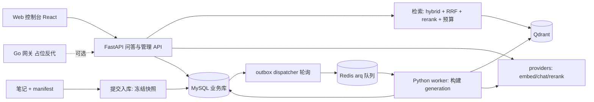

# 面试知识库 RAG · 面试讲解手册

- 文档用途：帮助在面试中清晰介绍本项目、回答深挖问题。**基于真实代码行为编写**，与设计稿不一致处以本文为准。
- 更新日期：2026-09-11。
- 配套阅读：[项目 README](../README.md)（怎么跑）、[设计文档](design.md)（当初的设计目标，含大量尚未实现的内容）。
- 关键提醒：`design.md` 开头写「尚未实现或连接外部服务」，是设计草案口吻；其中**鉴权、限流、分布式配额、缓存、可观测、LangGraph、压测、备份恢复**等代码里并不存在。面试时务必区分「已落地」和「设计目标」，详见 [第 8 节](#8-已实现-vs-未实现诚实清单)。

---

## 1. 电梯陈述

**30 秒版**

> 我做了一个版本化的 RAG 问答系统，用本地的 Agent 面试笔记当知识库。它的核心不是"调个向量库 demo"，而是把 RAG 当成一个**有数据一致性和版本边界的服务**来做：语料用显式 manifest 管理并冻结源快照，每次入库构建一个不可变的索引 generation，通过 MySQL 上的 compare-and-swap 原子发布；问答走 dense + 自实现中文 BM25 稀疏的混合检索、RRF 融合、可选 rerank、token 预算裁剪，再用 SSE 流式生成带引用的答案，并把答案和它用到的证据版本一起落盘，保证"旧答案永远能查到它当时引用的是哪一版笔记"。

**2 分钟版（在 30 秒基础上补充）**

- 形态：Python 模块化单体（FastAPI）+ arq 异步入库 worker + Qdrant 向量库 + MySQL 业务库 + Redis 队列；另有一个 Go 网关（目前只是占位反向代理，默认本地链路不经过它）。
- 两种运行模式：`local`（Qdrant 内嵌目录、无 MySQL/Redis、dense-only、单轮 JSON，用于零依赖快速调试）和 `server`（完整混合检索 + 多轮 + SSE + 版本管理）。同一套代码按配置切换。
- 我能讲清楚的技术点：generation 原子发布与跨存储一致性、自实现中文 BM25 稀疏检索、确定性 chunk/point ID 带来的幂等与复用、源快照冻结、SSE 事件协议与落盘时序、混合检索里"为什么用 dense 余弦分而不是 RRF 分做拒答"。
- 诚实边界：MVP（P0~P4）跑通了，但鉴权、限流、缓存、可观测、LangGraph 增强、压测和备份恢复都还是设计稿里的后续阶段，没实现。

---

## 2. 项目背景：要解决什么问题

通用 RAG demo 的痛点，正是本项目想正面处理的：

1. **"答案用的是哪一版知识？"** —— 笔记一直在改，普通 demo 直接覆盖向量库，旧答案的引用就失效了。本项目用不可变 generation + 答案证据落盘解决可追溯性。
2. **"上传 Markdown 就自动有中文检索了？"** —— Qdrant 支持 sparse vector，但不等于有合适的中文 BM25。本项目自己用 jieba + 自建词表实现 BM25 稀疏编码。
3. **"入库期间源文件被改了怎么办？"** —— 提交时冻结源字节快照，worker 只读快照不读工作区文件。
4. **"发布到一半失败会不会污染线上索引？"** —— MySQL 单一发布指针 + CAS，Qdrant 写成功但发布失败只留下未发布的孤儿 collection，旧服务不受影响。

这些都是后端工程师熟悉的**数据一致性、版本管理、幂等、事务边界**问题，正好把后端经验迁移到 RAG。

---

## 3. 架构总览（讲解脚本）



讲解时按这条线走：

1. **写入侧（入库）**：用户在控制台勾选语料 → 提交入库 → 冻结源快照写 MySQL → 事务性 outbox → dispatcher 投递 Redis → worker 读快照、切分、编码、构建新 generation 的 Qdrant collection → CAS 原子发布。
2. **读取侧（问答）**：固定当前 active generation → 查询编码 → dense + sparse 并行召回 → RRF 融合 → 阈值拒答 → 可选 rerank → token 预算裁剪 → SSE 流式生成 → 答案与引用落盘。
3. **存储分工**：MySQL 是业务权威（任务、版本指针、会话、答案、证据），Qdrant 是**可从冻结快照重建**的检索索引，Redis 只是队列 broker（不做缓存）。

> 一句话定调存储关系：**MySQL 是唯一发布权威，Qdrant 可重建，Redis 可丢。** 这是回答"跨存储一致性怎么保证"的总纲。

---

## 4. 核心链路逐段拆解

### 4.1 入库链路（server 模式，异步）

真实调用链（`application/ingestion_service.py` → `dispatcher.py` → `worker/jobs.py` → `build.py` → `publish.py`）：

1. **冻结快照**：`snapshot.freeze_documents` 把校验过 sha256 的原始字节写 `document_versions`（MEDIUMBLOB），manifest 原文写 `corpus_snapshots`，算出 `manifest_hash`。
2. **幂等键**：`idempotency_key = sha256(manifest_hash + 排序后的 doc_ids)`；同 key 且任务还在 queued/running/validating 直接返回旧任务，不重复构建。
3. **事务性 outbox**：一个事务里同时写 `ingestion_jobs`(queued) 和 `outbox_events`(ingestion_requested)，commit。
4. **dispatcher 投递**：轮询 outbox 里 pending 事件，用 `SELECT ... FOR UPDATE SKIP LOCKED` 抢占，投递到 arq Redis 队列，成功标记 dispatched。这是**至少一次投递**。
5. **worker 构建**：`build_job` 读 job → 标记 running → 记录发布前的 `expected_generation_id / expected_revision` → `build_generation`（**只读快照**，不碰工作区文件）→ 标记 validating → `publish_generation`（CAS）→ succeeded。
6. **build_generation 内部**：切分 → 分批并发 embedding（`asyncio.Semaphore` 限并发）→ `_build_sparse` 算 BM25 稀疏向量 → 新建 `gen_<id>` collection（dense + sparse 命名向量）→ 写 `index_generations`(validating, 含 bm25_stats) → chunk 按内容级去重复用（已存在的 chunk_id 不重插，只建 `generation_chunks` 关联）。

可讲的点：
- **为什么用 outbox 而不是直接发队列？** 防止"事务提交了但消息没发出去"或"消息发了但事务回滚"的不一致。任务事实和待投递事件在同一个 MySQL 事务里落定，dispatcher 再异步搬运，Redis 丢了也能从 outbox 恢复。
- **为什么 worker 只读快照？** 解决"入库期间源文件被改"的一致性窗口；也保证 PDF/Word 从冻结字节解析，索引可复现重建。
- **增量策略**：首版是"增量解析与 embedding + 全量新索引快照发布"——只对变化的文档付编码成本，但新 collection 装载全部启用 chunk。用较高的存储/向量复制成本换一致的版本边界，适合当前规模。

### 4.2 generation 原子发布（最能体现分布式功底）

`application/publish.py`：

- `corpora` 表持 `active_generation_id` + 单调递增 `publication_revision`，是**唯一发布指针**。
- 发布时 `SELECT ... FOR UPDATE` 锁 corpus 行和目标 generation 行，做**双重 CAS**：`active_generation_id == expected_generation_id` 且 `publication_revision == expected_revision`，任一不符抛 `PublishConflict` → HTTP 409。
- 通过后：旧 active 降级为 `ready`（保留作回滚对象），目标升 `active`，`publication_revision + 1`，commit。
- 回滚走同一 CAS 接口（只比 revision）。
- worker 在构建前记录 expected 值，保证"较早提交的任务即使晚完成，也不会覆盖更新的语料"——期间若被抢先发布，CAS 失败抛冲突。

可讲的点：
- **跨存储一致性**：先写 Qdrant collection(validating)，再 MySQL CAS 发布。Qdrant 写成功但 MySQL 发布失败 → 只留下未发布的孤儿 collection，旧服务不受影响；`cleanup.py` 负责按保留策略清理旧 collection（绝不删 active）。
- **为什么不用 Qdrant alias 当切换开关？** 避免出现"第二个权威"。MySQL active generation 是唯一真相，查询开始时读它并固定，后续直接访问对应物理 collection。
- 这是一个标准的**乐观并发控制 + 单调版本号**模式，和数据库的 MVCC、分布式锁的 fencing token 是同一类思想。

### 4.3 问答链路（server 模式）

`application/query_generation.py`：

1. `_load_generation`：读 `corpora.active_generation_id`，**固定本次 generation**（整个请求期间不变）。
2. 查询编码 → **维度/模型一致性校验**（防止用 A 模型的查询向量去查 B 模型的索引）。
3. `build_sparse_query`：从 generation 冻结的 `bm25_stats` 还原词表，编码查询稀疏向量。
4. `hybrid_search`：dense_limit=30、sparse_limit=30，并行召回，RRF 融合保留 final_limit=20。
5. **阈值拒答**：dense top-1 余弦分 < `retrieval_min_score`(默认 0.4) 就拒答。
6. 可选 rerank：`top_n = max(top_k, 8)`，失败降级回 RRF 顺序。
7. `select_within_budget`：按 `context_max_tokens=6000` 顺序累加裁剪证据。
8. 多轮历史：取最近 20 条消息，按 `_HISTORY_MAX_TOKENS=2000` 从新到旧截断。
9. `answer_question_stream`：SSE 事件 **meta → delta\* → citations → done**，异常发 **error**。**流式完整结束后才落盘**答案和消息。

可讲的点：
- **为什么不把检索和生成并行？** 必须先完成检索和证据选择，再开始依赖这些证据的生成；并行会破坏 RAG 的因果依赖。
- **量纲分离的取舍（高频追问）**：RRF 用排名倒数融合，避免 dense 余弦分和 BM25 分这种不同量纲的分数直接相加；但**拒答阈值坚持用 dense top-1 余弦分**，因为它和 embedding 空间同量纲、可解释，RRF 分只用于排序。
- **SSE 落盘时序的诚实边界**：客户端中途"停止接收"时 Starlette 会取消生成器，但代码**没有写 interrupted/failed 状态，部分答案不会保存**。这点 README 已诚实说明——面试被问到时不要谎称做了断点续传。

### 4.4 混合检索三件套（`retrieval/`）

- **hybrid.py**：`rrf_fuse` 用 `1/(k+rank)`（k=60）融合两个有序列表；`hybrid_search` 用 `asyncio.gather + asyncio.to_thread` 把同步的 QdrantClient 放线程池并行召回，避免阻塞事件循环。
- **sparse.py（自实现中文 BM25，亮点）**：
  - jieba 分词（小写化、保留 `RAG`/`top-k` 等英文术语）。
  - 自建 `Vocabulary`：词项 → 稳定整数 ID（Qdrant sparse 用整数索引），随 generation 冻结进 MySQL JSON。
  - 文档侧编码 TF × 长度归一化项 `(freq*(k1+1))/(freq + k1*length_norm)`，k1=1.5、b=0.75。
  - 查询侧编码 IDF `log((N-n+0.5)/(n+0.5)+1)`。
  - **IDF 只放查询侧、不叠加 Qdrant 的 IDF modifier，避免重复加权**；新 generation 重算全局词频/平均长度，不沿用旧统计。
- **budget.py**：`estimate_tokens` 用字符近似（CJK 1 字符≈1 token，其他 4 字符≈1 token）；顺序累加到超预算为止，至少保留 min_hits 条。

> 这是回答"Qdrant 支持 sparse 不等于有合适的中文 BM25"这一认知点的落地证据，强烈建议作为亮点详讲。

### 4.5 解析、切分与确定性 ID

- **chunking.py**：标题感知切分，用栈维护标题层级、**跟踪代码围栏**（``` / ~~~ 内的 `#` 不当标题）。`chunk_id = sha256(doc_id, source_hash, heading, start_line, end_line, text)[:32]`，Qdrant point ID = `uuid.UUID(hex=chunk_id)`。embed 输入 = 标题>章节路径 + 正文。
  - **诚实点**：实现是**正则 + 围栏状态机**，不是 design 说的 markdown-it-py 语法树；chunk 大小是 `max_chars=1200` 字符、**无 overlap**，不是 design 说的 400~800 token + overlap。被追问时如实说"首版用正则够用，AST 解析和 overlap 是后续优化项"。
- **document_processing.py**：`.md/.txt` 多编码解码（UTF-8/UTF-16/GB18030）；`.pdf` pypdf 逐页（任一页无文字即报错，不静默丢弃）；`.docx` python-docx 按正文+表格顺序；`.doc` macOS textutil / antiword 子进程。上限单文件 5MiB、提取 200 万字符、PDF 500 页、DOCX 解压 32MiB。
- **manifest.py**：扫描限定 `corpus/` 白名单；`resolve_source_path` 防绝对路径/`..`/符号链接越界；保存用临时文件 + `fsync` + `os.replace` **原子写**。

可讲的点（确定性 ID 的三个好处）：
1. **upsert 幂等**：重复投递同一构建不产生脏数据。
2. **跨 generation 复用**：内容相同的 chunk 已存在则只建关联、不重插，省存储和编码成本。
3. **合法 point ID**：把任意 SHA 字符串截断后转成 UUID，避免把非法字符串直接当 Qdrant point ID。

---

## 5. 关键技术决策与 trade-off（面试官最爱问"为什么"）

| 决策 | 选择 | 理由 | 代价 / 边界 |
|---|---|---|---|
| 服务形态 | Python 模块化单体 + arq worker，不拆微服务 | 在线服务和 worker 共享业务模块，分别扩容；首版拆微服务是过度设计 | 单体边界靠包结构维持，规模大了要拆 |
| 语言分工 | Python 核心 + Go 网关占位 | Python 贴 AI 生态；Go 练接入层/并发/流式代理 | 网关目前只是反代占位，默认链路不经过它，**不能声称做了鉴权/限流** |
| 向量库 | Qdrant（local 内嵌 / server 服务双后端） | 同一 API 封装两种后端，零依赖调试 + 完整检索 | 内嵌模式不能多进程共享 |
| 发布机制 | MySQL 单一指针 + 双 CAS，不用 Qdrant alias | 避免双权威，版本边界清晰 | 每次发布全量新 collection，存储成本换一致性 |
| 入库可靠性 | 事务性 outbox + dispatcher + arq 至少一次 | 防止事务与消息不一致 | **没有租约/心跳/退避**，过期 worker 防护未实现（表字段建了但不用） |
| 中文稀疏检索 | 自实现 BM25（jieba + 自建词表） | Qdrant sparse 不自动给合适的中文 BM25 | 词表/分词需自行校准，依赖固定版本 jieba |
| 检索融合 | RRF（排名倒数） | 避免不同量纲分数直接相加 | 拒答另用 dense 余弦分，不用 RRF 分 |
| 切分 | 正则标题 + 围栏状态机，1200 字符无 overlap | 首版够用、可追踪源行号 | 不如 AST 精确，无 overlap 可能切断上下文 |
| 答案证据 | 落盘引用快照（doc_id/路径/标题/行号/证据文本+hash） | 旧答案可追溯当时证据 | 不保证云端模型逐字复现同一答案 |

---

## 6. 技术亮点深挖（建议重点讲的 6 个）

1. **generation 原子发布**：MySQL 双 CAS + 行锁 + 单调 revision，跨存储一致性（MySQL 权威 / Qdrant 可重建）。最能体现分布式一致性功底。
2. **自实现中文 BM25 稀疏检索**：jieba + 自建 Vocabulary + 文档侧 TF×长度归一化 / 查询侧 IDF + 不叠加 Qdrant IDF modifier。
3. **源快照冻结 + worker 只读快照**：消除入库期间源文件变化的一致性窗口，保证可复现重建。
4. **确定性 chunk/point ID**：sha256 派生 UUID，带来幂等 upsert、跨代复用、合法 point ID。
5. **混合检索的量纲分离**：RRF 排序 vs dense 余弦拒答，能讲清"为什么不用融合分做拒答"。
6. **SSE 事件协议 + 落盘时序**：固定 `meta→delta*→citations→done`，前端测试覆盖跨包 UTF-8、CRLF、心跳注释行、多行 data、提前断开、JSON 误判等边界。

**额外的工程细节（可加分）**：
- `GET /v1/index-generations` 刻意**不查 bm25_stats 宽 JSON 列**、按主键倒序走索引，避免 MySQL `1038 out of sort memory`——这是一个真实的 MySQL 性能排障点，有回归测试覆盖，非常适合讲。
- `serve.py` 进程组监管：每个子进程 `start_new_session=True` 独立进程组，Ctrl+C 只 `killpg` 自己这组，8 秒后 SIGKILL 兜底。
- httpx 按 base_url 复用连接池；VectorStore / Database 按 key 复用客户端。
- 路径安全：`resolve_source_path` 防越界，扫描限定白名单目录，有越界回归测试。

---

## 7. 高频面试问题与参考答案

### 基础理解

**Q：简单说说你这个 RAG 系统的整体流程。**
A：写入侧——勾选语料、冻结源快照、事务性 outbox 投递、worker 读快照切分编码、构建不可变 generation、CAS 原子发布。读取侧——固定 active generation、查询编码、dense+sparse 并行召回、RRF 融合、阈值拒答、可选 rerank、token 预算裁剪、SSE 流式生成带引用的答案、答案与证据落盘。

**Q：为什么用混合检索而不是只用向量检索？**
A：纯 dense 向量对术语精确匹配（如 `top-k`、`RRF` 这种专有词）和关键词召回不敏感；BM25 稀疏检索擅长精确词项匹配。两者互补，用 RRF 按排名融合，兼顾语义相似和词面命中。评估脚本里也对比了 dense / hybrid / hybrid+rerank 三种模式的 Recall@k 和 MRR。

**Q：RRF 是什么？为什么用它而不是把分数相加？**
A：Reciprocal Rank Fusion，`score = Σ 1/(k+rank)`，k 通常取 60。它只看排名不看绝对分数，避免 dense 余弦分（0~1）和 BM25 分（量纲不同、可能很大）直接相加导致的尺度失衡。

### 深挖一致性 / 工程

**Q：入库到一半服务挂了，索引会不会处于半发布的脏状态？**
A：不会。发布是 MySQL 事务里的 CAS 操作，要么成功切换 active generation 要么不变。Qdrant collection 在发布前是 validating 状态的孤儿，旧 active 仍在服务。worker 重启后任务状态、outbox 和（设计上的）心跳可重新调度——但我要诚实说，**租约和心跳目前只建了表字段，代码没真正用**，可靠重试还不完整。

**Q：怎么保证"旧答案能查到它当时引用的证据"？**
A：答案落盘时记录了 index_generation、manifest_hash 和每条引用的 doc_id、路径标题快照、source_version、行号范围、实际证据文本及其 hash。笔记后续被改或停用都不影响已保存的证据快照。

**Q：两个入库任务并发完成，谁赢？**
A：先发布的赢。后发布的任务在 CAS 时发现 `expected_generation_id/revision` 已不匹配，抛 PublishConflict（409），需要重新比较后决定是否重建。这保证较早提交的任务即使晚完成也不会覆盖更新的语料。

### 检索质量

**Q：拒答是怎么做的？阈值怎么定？**
A：用 dense top-1 的余弦分和 `retrieval_min_score`（默认 0.4）比较，低于就拒答或说明证据缺口。阈值需要根据固定评估集校准，不能把 rerank 分数当通用概率。**注意拒答用的是 dense 余弦分而不是 RRF 融合分**，因为前者同量纲、可解释。

**Q：你的中文 BM25 是怎么实现的？**
A：jieba 分词后建一个词项→稳定整数 ID 的 Vocabulary。文档侧编码 TF×长度归一化项，查询侧编码 IDF，通过 Qdrant 稀疏向量点积检索。IDF 只放查询侧，不叠加 Qdrant 自带的 IDF modifier，避免重复加权。每个 generation 冻结自己的词表和 BM25 统计（DF、chunk 数、平均长度），文档更新会重算全局词频，不沿用旧统计。

### 反思 / 系统设计

**Q：如果知识库涨到几百万文档，你现在的设计哪里会崩？**
A：①每次发布全量构建新 collection 的存储/向量复制成本会很高，需要改成真正的增量索引或别名切换；②没有缓存，热点查询会重复打模型；③没有分布式配额，多副本会打爆模型 RPM/TPM；④评估只有 30 条文档级标注，需要扩到证据级和更大样本。

**Q：为什么不上 LangChain / LangGraph？**
A：基础 RAG 我选择显式 Python 编排，是为了让检索策略、引用、预算和降级边界都清楚可控，不被高层封装黑盒化。LangGraph 适合有分支和循环的增强流程（查询改写、补充检索、证据检查），我把它列为 P5，但**目前没实现**，pyproject 里也没有这些依赖。

**Q：网关为什么用 Go 又不真正用它？**
A：保留 Go 网关是为了练习接入层（反向代理、流式透传、并发、健康检查、优雅关停），目前它只实现了 `httputil.ReverseProxy` + `FlushInterval=-1` 保证 SSE 不被缓冲 + 健康检查。鉴权、限流、trace 传播是设计里的 P3，但没补齐。默认本地 make 链路直接起 Python API、不经过网关，网关只在 Docker Compose 的 app profile 里出现。

---

## 8. 已实现 vs 未实现（诚实清单）

> 这一节是面试的"安全带"。把没做的说成做了，被追问一句就穿帮；主动划清边界反而显得可靠。

**已扎实落地（可放心深讲）**：
- 显式 manifest + sha256 校验 + 原子写
- 源快照冻结（document_versions / corpus_snapshots），worker 只读快照
- 不可变 generation + corpora 单一发布指针 + 双 CAS 原子发布/回滚
- 事务性 outbox + dispatcher（SKIP LOCKED）+ arq 至少一次投递
- 自实现中文 BM25 稀疏检索 + RRF 混合 + 可选 rerank + token 预算
- 确定性 chunk_id / point ID + 内容级 chunk 复用
- 多轮历史截断、SSE 事件协议、答案与引用版本化落盘
- 多格式解析（md/txt/pdf/docx/doc）、路径安全、local/server 双模式
- mock 模型（特征哈希 embedding，确定性）、30 条文档级检索评估

**完全未实现（design 写了，代码里没有，别说成做了）**：
- 鉴权 / 角色（reader/admin）/ API Key —— 所有路由无入站认证
- 限流（网关 Redis 限流、入口连接数限制）
- 分布式配额（跨副本 RPM/TPM/在途额度、token 预算结算）—— 只有进程内 Semaphore 控 embedding 并发
- 缓存（语义缓存 / 精确问答缓存 / Embedding 缓存）—— Redis 仅作队列 broker；`embed_input_hash` 列恒为空
- LangGraph 增强流程 / LangChain 组件
- 可观测：OTEL / Prometheus / Grafana / Langfuse / trace 传播 —— 只有结构化 JSON 日志
- 压测（k6、100 并发 SSE）
- 备份 / 恢复 / RPO / RTO
- feedback（赞踩）/ audit_events（审计）—— 表和接口都没有
- 重试退避（Retry-After / 指数退避 / 备选模型切换）—— 只有 arq `max_tries=3`
- 租约 / 心跳 / 过期 worker 校验 —— 表字段建了但代码不用
- manifest CLI 的 add/refresh/diff —— CLI 只有 validate
- 同一会话单在途生成锁、request_id 贯穿、答案 token 与费用记录

**简化实现（做了但比 design 弱）**：
- 切分：正则标题 + 1200 字符无 overlap（design 要 AST + token + overlap）
- 发布校验：validating 基本直接发布，无独立 smoke test 关卡
- 取消传播：靠 Starlette 隐式取消，不写中断状态、部分答案不落盘
- 评估：30 条文档级（design 要 ≥50 条证据级 + 多指标 + judge 校准）
- 网关：占位反代，默认链路绕过它

---

## 9. 如果重做 / 下一步会怎么改

- **可靠任务**：补上租约续期 + 心跳 + 指数退避 + 过期 worker fencing，让"至少一次"真正可恢复。
- **检索质量**：切分改成 markdown AST + overlap；评估扩到证据级标注、更大样本、真实质量基线和 LLM-as-judge 校准。
- **性能**：加 Embedding 缓存（真实写入 `embed_input_hash`）和精确问答缓存；多副本前加分布式配额。
- **生产化**：补鉴权/角色、可观测（OTEL + 指标）、压测、备份恢复演练，再谈"生产可用"。
- **增强问答**：用 LangGraph 做受预算约束的查询改写 + 补充检索 + 证据检查，复杂问题才进增强流程。

---

## 10. 自检问题（讲解前过一遍）

1. 我能不看代码画出入库和问答两条链路吗？
2. 被问"半发布脏状态"时，我能用 CAS + 孤儿 collection 解释清楚吗？
3. 我能说清"为什么拒答用 dense 余弦分而不是 RRF 分"吗？
4. 被问"用了 LangChain 吗 / 网关做了鉴权吗 / 有缓存吗"时，我会如实说没有吗？
5. 我能讲清自实现 BM25 的文档侧和查询侧分别编码什么吗？
6. 我能用"MySQL 权威 / Qdrant 可重建 / Redis 可丢"一句话概括存储分工吗？
